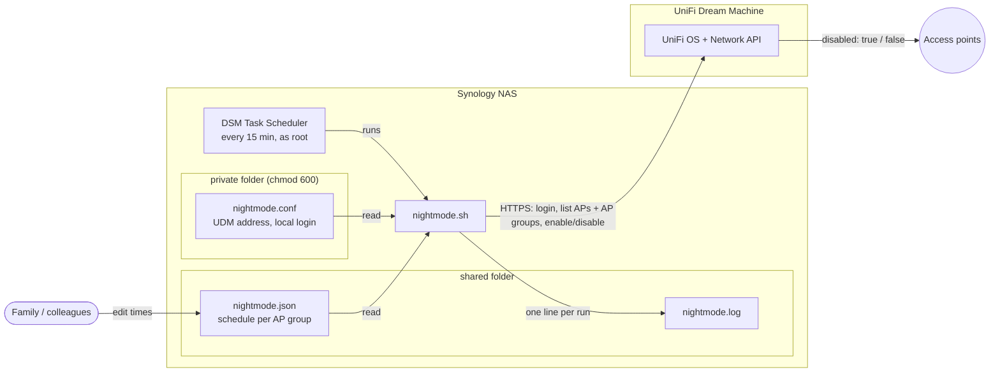
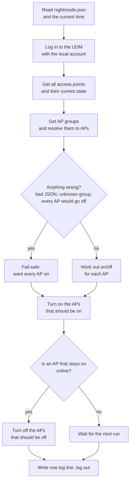

# UniFi Wi-Fi NightSleep

**Put your UniFi access points to sleep at night, on a schedule you set per AP group.**

NightMode is a small shell script that switches UniFi access points off and back on by time of day. Each UniFi AP Group gets its own "off" window: the living areas can go dark at 19:00, the bedrooms at 22:00, and the hallway AP can stay on all night. It runs every 15 minutes from the DSM Task Scheduler on a Synology NAS, talks to your UniFi Dream Machine over its local API, and needs nothing but `sh`, `curl` and `awk`. No Docker, no Python, no cloud.


## Why

- **Less radio at night.** Fewer APs broadcasting while everyone sleeps.
- **Less power.** Idle APs still draw power. Switched off, they don't.
- **Still connected.** The APs you choose stay on, so phones, alarms and smart home devices keep working.
- **Anyone can change the schedule.** The times live in a plain JSON file on a shared folder, so people who never open the UniFi app can edit them.

## What a day looks like

With the example [`nightmode.json`](nightmode.json):

```json
{
  "enabled": true,
  "default": { "off_from": "19:00", "off_until": "08:00" },
  "groups": [
    { "group": "Evening", "off_from": "22:00", "off_until": "06:00" },
    { "group": "Night", "off": "never" }
  ],
  "ignore": []
}
```

| Time | APs on | APs off |
|---|---|---|
| 08:00 to 19:00 | all | none |
| 19:00 to 22:00 | Evening, Night | all other APs |
| 22:00 to 06:00 | Night | everything else |
| 06:00 to 08:00 | Evening, Night | all other APs |

The groups are the AP Groups you already have in UniFi Network. To move an AP to another phase, change its group in UniFi. The JSON stays the same.

## Features

- **Per-group schedules.** A default window for APs in no listed group, plus one window per AP Group. Windows can cross midnight, and a group can be `"off": "never"` or `"off": "always"`. Single APs can be listed by name or MAC instead of a group.
- **Reconcile, don't toggle.** Every 15 minutes the script reads the real state of each AP and only changes the ones that are wrong. A missed run, a reboot or a manual change in the UniFi UI fixes itself on the next run, and edits to the JSON take effect within 15 minutes.
- **Shared JSON for non-IT editors.** `nightmode.json` sits on a shared folder that others can edit. It has no secrets in it.
- **Local credentials stay private.** The UDM address and login live in `nightmode.conf` in a private folder with `chmod 600`. The file is read as plain `KEY=VALUE` and never executed, and it is ignored by git.
- **Fail-safe by design.** If the JSON is missing or broken, a time is invalid, a group can't be found, or the schedule would turn off every AP, the script turns **all APs on** and logs why. It only turns APs off once at least one AP that stays on is online, and it switches APs on before it switches any off.
- **Safe to try.** `--list` shows every AP and AP Group, `--dry-run` shows what would change, and `--debug` shows the controller's answers with passwords and tokens hidden.
- **One log line per run** in a log file that trims itself, so anyone can see what happened and when.
- **Only access points.** It only touches devices of type `uap`. The UDM, switches and gateways are never changed. APs listed in `ignore` are left alone.

## Architecture



Each run goes through the same steps:



The script talks to these UniFi OS endpoints on the UDM:

| Purpose | Request |
|---|---|
| Log in / out | `POST /api/auth/login`, `POST /api/auth/logout` (with the CSRF token) |
| List devices | `GET /proxy/network/api/s/<site>/stat/device` |
| List AP groups | `GET /proxy/network/v2/api/site/<site>/apgroups` (UniFi Network 8+) |
| Switch an AP | `PUT /proxy/network/api/s/<site>/rest/device/<id>` with `{"disabled": true}` or `false` |

Switching an AP off is the same as "Disable" on a device in the UniFi UI. The AP stays adopted and keeps its config.

## Files

| File | Where it lives | Who edits it |
|---|---|---|
| [`nightmode.sh`](nightmode.sh) | private folder on the NAS | nobody |
| [`nightmode.conf.example`](nightmode.conf.example) | copy to `nightmode.conf` next to the script, `chmod 600` | you (UDM address, login, paths) |
| [`nightmode.json`](nightmode.json) | shared folder | anyone allowed to change the schedule |
| `nightmode.log` | shared folder (set by `LOG_FILE`) | written by the script |

## Quick start

1. In UniFi OS, create a **local-only** admin account for the script with access to the Network app only.
2. Copy `nightmode.sh` and `nightmode.conf.example` to a private folder on the NAS, rename the example to `nightmode.conf` and fill it in.
3. Put `nightmode.json` on a shared folder and set your groups and times.
4. Check that it can see your APs and groups, then preview what it would do:
   ```sh
   sh nightmode.sh -c nightmode.conf --list
   sh nightmode.sh -c nightmode.conf --dry-run
   ```
5. Add a DSM scheduled task that runs it every 15 minutes as `root`.

The full guide, including the account permissions, the Task Scheduler settings, testing from a Mac and all JSON options, is in **[SETUP.md](SETUP.md)**.

## Usage

```
nightmode.sh [-c local.conf] [--dry-run] [--list] [--debug]
  -c FILE     local settings file (default: nightmode.conf next to the script)
  --dry-run   show what would change, change nothing
  --list      print all APs (name, MAC, state) and all AP groups, then exit
  --debug     print the HTTP status and start of each controller response
              (passwords, keys and tokens are redacted)
```

Set `NIGHTMODE_NOW=HH:MM` to pretend it is another time of day, for example `NIGHTMODE_NOW=23:30 sh nightmode.sh --dry-run`.

## Requirements

- A UniFi OS console, such as a UniFi Dream Machine, with UniFi Network 8 or newer for AP groups.
- A machine that can reach it over HTTPS with `sh`, `curl`, `awk`, `sed`, `grep` and `tr`. A Synology NAS has all of them out of the box, and so does a Mac.

## Status

The script has been tested on Linux against a simulated UDM, but not yet against a real UDM or Synology. Please start with `--list` and `--dry-run`. SETUP.md lists the [assumptions to check](SETUP.md#assumptions-to-check-on-your-setup).
